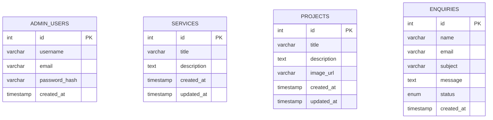

# Entity Relationship Diagram (ERD)

## Database: nexora_db

This diagram represents the four tables in the Nexora Digital Solutions website database.

## Explanation

- **admin_users:** Stores administrator accounts and securely hashed passwords.
- **services:** Stores the services displayed on the website.
- **projects:** Stores portfolio project information and optional image URLs.
- **enquiries:** Stores visitor messages and their processing status.

Each table has its own primary key (`id`). The current schema does not define foreign-key relationships between these tables.
