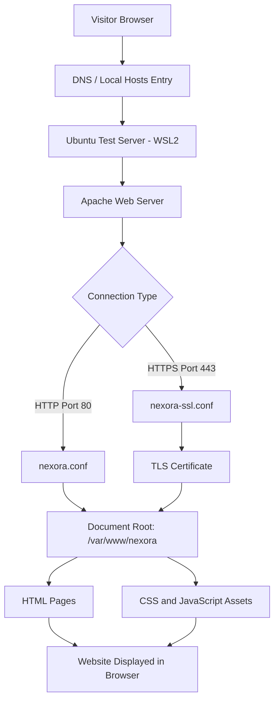

# Nexora Website Deployment Flow

## Explanation

1. The visitor enters `nexora.local` in a browser.
2. The local hosts configuration resolves the hostname.
3. The request reaches the Ubuntu WSL2 test environment.
4. Apache selects the matching virtual host.
5. HTTP uses port 80; HTTPS uses port 443 and TLS.
6. Apache serves the website from `/var/www/nexora`.
7. The browser displays the HTML pages and supporting assets.
